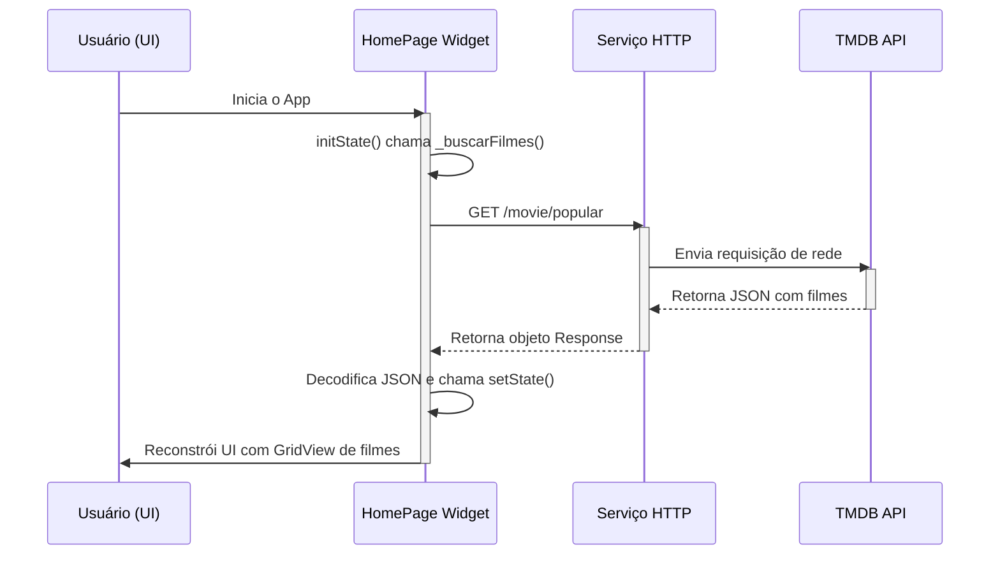

<div align="center">

# 🎬 Estudo de Caso: App Mobile com Flutter e API REST

**Um aplicativo de catálogo de filmes construído em Flutter para demonstrar a aplicação prática de conceitos essenciais do desenvolvimento mobile, incluindo consumo de APIs, gerenciamento de estado e construção de interfaces de usuário declarativas.**

<br>


<br>
<br>


</div>

---

> 💡 **Nota do Desenvolvedor:** Este projeto foi minha porta de entrada para o universo mobile com Flutter. O desafio não era simplesmente exibir uma lista de filmes, mas sim construir uma aplicação coesa, performática e que seguisse as boas práticas do ecossistema Dart. É a minha demonstração de como orquestrar chamadas de rede, gerenciar o ciclo de vida de um widget e criar uma experiência de usuário fluida, mesmo lidando com dados assíncronos.

<br>

## 📜 Índice

* [✨ Funcionalidades](#-funcionalidades)
* [🏆 Vitrine Técnica: Conceitos Aplicados](#-vitrine-técnica-conceitos-aplicados)
* [🏛️ Fluxo de Dados da Aplicação](#️-fluxo-de-dados-da-aplicação)
* [🚀 Como Executar o Projeto](#-como-executar-o-projeto)

---

## ✨ Funcionalidades

| Funcionalidade | Descrição | Status |
| :--- | :--- | :---: |
| 🎞️ **Catálogo de Filmes Populares** | Exibe uma grade rolável com os filmes mais populares, consumidos em tempo real da API do TMDB. | ✅ |
| 🖱️ **Navegação para Detalhes** | Permite que o usuário toque em um pôster para navegar a uma tela específica com informações detalhadas do filme. | ✅ |
| 📝 **Página de Detalhes Completa** | Apresenta o pôster, título, avaliação e a sinopse do filme selecionado. | ✅ |
| 🔐 **Gerenciamento de Chave de API** | Utiliza um arquivo `.env` para armazenar a chave da API, uma prática de segurança padrão. | ✅ |

---

## 🏆 Vitrine Técnica: Conceitos Aplicados

Este projeto foi deliberadamente estruturado para ser uma vitrine dos padrões de desenvolvimento em Flutter.

| Conceito-Chave | Implementação e Justificativa |
| :--- | :--- |
| 🧬 **Gerenciamento de Estado Simples (`StatefulWidget`)** | O núcleo da reatividade do app. A tela principal é um **`StatefulWidget`**, que detém o estado da lista de filmes. A chamada ao método **`setState()`** após a resposta da API notifica o framework para reconstruir a UI com os novos dados, garantindo que a tela sempre reflita o estado atual da aplicação. |
| 🌐 **Programação Assíncrona (`async/await`)** | Essencial para uma UX fluida. A busca de filmes é feita de forma assíncrona, garantindo que a thread principal (UI) não seja bloqueada enquanto a aplicação espera a resposta da API. Isso evita que o app "congele", uma prática fundamental no desenvolvimento mobile. |
| 🚀 **Performance com `GridView.builder`** | Em vez de renderizar todos os itens de uma vez, foi utilizado o construtor `.builder`. Ele implementa o padrão de **virtualização de lista**, criando os widgets dos filmes sob demanda, conforme o usuário rola a tela. Isso garante uma performance excelente e baixo consumo de memória, mesmo com milhares de itens. |
| 📦 **Consumo de API REST (Pacote `http`)** | O pacote **`http`** foi usado para realizar requisições `GET` à API do TMDB. A resposta, em formato **JSON**, é decodificada com o `dart:convert`, transformando o texto em um `Map` estruturado que o Dart pode manipular de forma segura e tipada. |
| ↔️ **Navegação e Passagem de Dados (`Navigator`)** | A transição entre a lista e a tela de detalhes é gerenciada pelo `Navigator`. Os dados do filme selecionado são passados para a tela de detalhes via **construtor**, uma abordagem limpa que torna o widget de detalhes reutilizável e fácil de testar. |

---

## 🏛️ Fluxo de Dados da Aplicação

O diagrama de sequência abaixo ilustra o fluxo unidirecional de dados na aplicação, desde a interação do usuário até a renderização da UI.



---

## 🚀 Como Executar o Projeto

### Pré-requisitos
* [Flutter SDK](https://docs.flutter.dev/get-started/install) instalado.
* Uma chave de API do [The Movie Database (TMDB)](https://www.themoviedb.org/signup).

### Passos
1.  **Clone o repositório:**
    ```bash
    git clone [https://github.com/gui-ccr/MovieFlix_App.git](https://github.com/gui-ccr/MovieFlix_App.git)
    cd MovieFlix_App/movieflix
    ```
2.  **Crie o arquivo de ambiente:**
    * Na raiz da pasta `movieflix`, crie um arquivo chamado `.env`.
    * Dentro deste arquivo, adicione a sua chave da API da seguinte forma:
      ```
      TMDB_API_KEY=SUA_CHAVE_DE_API_AQUI
      ```
3.  **Instale as dependências:**
    ```bash
    flutter pub get
    ```
4.  **Execute a aplicação:**
    ```bash
    flutter run
    ```
